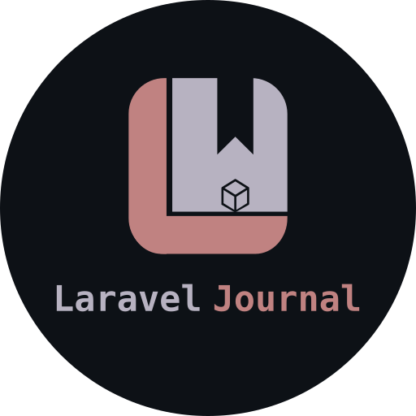

<p align="center">
  
</p>

[](https://github.com/jakub-gawlik/laravel-journal/actions/workflows/ci.yml)
[](https://packagist.org/packages/jgawlik/laravel-journal)
[](LICENSE)

A private, per-user journal JSON API for Laravel: posts, categories and tags,
with search, sorting and pagination.

- Every user sees only their own posts and tags. Requests for another user's
  records return `404`, so IDs can't be probed.
- Categories are shared between users. Who may manage them is decided by a gate
  that your app defines.
- Works with integer, UUID and ULID user keys.

## Requirements

- PHP 8.2+
- Laravel 12 or 13

## Installation

```bash
composer require jgawlik/laravel-journal
```

The service provider is auto-discovered.

If your user model is not `App\Models\User`, publish the config and set
`user_model` **before** migrating. The migration uses it to create foreign keys
of the matching type.

```bash
php artisan vendor:publish --tag=journal-config
php artisan migrate
```

Optionally, seed a few starter categories (Personal, Work, Travel, Ideas,
Learning):

```bash
php artisan db:seed --class="Jgawlik\LaravelJournal\Database\Seeders\CategorySeeder"
```

### Publishing the migrations

The migrations run straight from the package by default. To customise them,
publish them **and** turn off the package's own copy, or they will run twice:

```bash
php artisan vendor:publish --tag=journal-migrations
```

```php
// config/journal.php
'run_migrations' => false,
```

## Authentication

Routes use the `api` and `auth:sanctum` middleware by default. Sanctum is not
installed by this package, so either install it (`php artisan install:api`) or
point `routes.middleware` at another guard:

```php
// config/journal.php
'routes' => [
    'middleware' => ['api', 'auth:api'],
    // ...
],
```

## Managing categories

Anyone signed in can list and view categories, but creating, updating and
deleting them is denied until you define the gate, for example in
`AppServiceProvider::boot()`:

```php
use Illuminate\Support\Facades\Gate;
use Jgawlik\LaravelJournal\JournalServiceProvider;

Gate::define(JournalServiceProvider::MANAGE_CATEGORIES, fn (User $user) => $user->is_admin);
```

## Configuration

| Key                       | Default                   | Description                                                   |
| ------------------------- | ------------------------- | ------------------------------------------------------------- |
| `routes.enabled`          | `true`                    | Set to `false` to register the routes yourself.               |
| `routes.prefix`           | `api/journal`             | URL prefix for every endpoint.                                |
| `routes.middleware`       | `['api', 'auth:sanctum']` | Middleware for every endpoint. It must authenticate the user. |
| `routes.name`             | `journal.`                | Route name prefix, e.g. `journal.posts.index`.                |
| `user_model`              | `App\Models\User`         | The model that owns posts and tags.                           |
| `run_migrations`          | `true`                    | Set to `false` after publishing the migrations.               |
| `pagination.per_page`     | `15`                      | Default page size.                                            |
| `pagination.max_per_page` | `100`                     | Largest `per_page` a client may request.                      |

If you register the routes yourself, keep the route parameter names `post`,
`category` and `tag`.

## API

All endpoints are relative to the prefix (`/api/journal` by default) and return
JSON.

| Method        | Endpoint             | Description                                               |
| ------------- | -------------------- | --------------------------------------------------------- |
| `GET`         | `/posts`             | List your posts                                           |
| `POST`        | `/posts`             | Create a post                                             |
| `GET`         | `/posts/{id}`        | Show a post                                               |
| `PUT`/`PATCH` | `/posts/{id}`        | Update a post                                             |
| `DELETE`      | `/posts/{id}`        | Delete a post                                             |
| `GET`         | `/tags`              | List your tags                                            |
| `POST`        | `/tags`              | Create a tag                                              |
| `GET`         | `/tags/{slug}`       | Show a tag                                                |
| `PUT`/`PATCH` | `/tags/{slug}`       | Update a tag                                              |
| `DELETE`      | `/tags/{slug}`       | Delete a tag (it is removed from its posts)               |
| `GET`         | `/categories`        | List categories                                           |
| `POST`        | `/categories`        | Create a category (gated)                                 |
| `GET`         | `/categories/{slug}` | Show a category                                           |
| `PUT`/`PATCH` | `/categories/{slug}` | Update a category (gated)                                 |
| `DELETE`      | `/categories/{slug}` | Delete a category (gated; its posts become uncategorised) |

### Listing

Every list endpoint accepts:

| Parameter   | Description                                                                                                                        |
| ----------- | ---------------------------------------------------------------------------------------------------------------------------------- |
| `search`    | Case-insensitive match on title and content (posts) or name and slug (tags, categories).                                           |
| `sort`      | Posts: `title`, `created_at`, `updated_at`. Tags and categories: `name`, `slug`, `created_at`, `updated_at`. Default `created_at`. |
| `direction` | `asc` or `desc`. Default `desc`.                                                                                                   |
| `per_page`  | Page size, up to `pagination.max_per_page`.                                                                                        |
| `page`      | Page number.                                                                                                                       |

`/posts` also accepts `category` and `tag`, each a slug (lowercase letters,
numbers and single hyphens).

```
GET /api/journal/posts?search=holiday&tag=travel&sort=title&direction=asc&per_page=20
```

Responses are standard Laravel paginated resources, with `data`, `links` and
`meta`.

### Posts

| Field         | Rules                                                                                                                                                                                                                                                                                                                                              |
| ------------- | -------------------------------------------------------------------------------------------------------------------------------------------------------------------------------------------------------------------------------------------------------------------------------------------------------------------------------------------------- |
| `title`       | Required on create. Up to 255 characters.                                                                                                                                                                                                                                                                                                          |
| `content`     | Required on create.                                                                                                                                                                                                                                                                                                                                |
| `slug`        | Optional. Lowercase letters, numbers and single hyphens, unique among your posts. Generated from the title on create (`my-day`, `my-day-2`, …) and never changed automatically.                                                                                                                                                                    |
| `cover_image` | Optional `http`/`https` URL, up to 2048 characters.                                                                                                                                                                                                                                                                                                |
| `category_id` | Optional ID of an existing category, or `null`.                                                                                                                                                                                                                                                                                                    |
| `tags`        | Optional array of up to 20 tag names. Missing tags are created for you. Names are matched by their slug, so `Road Trip` and `road trip` are the same tag, and a name that has no letters or digits once transliterated to ASCII (for example `!!!`) is skipped. On update, the list replaces the post's tags, and `[]` or `null` removes them all. |

```http
POST /api/journal/posts
Content-Type: application/json

{
    "title": "First day in Kraków",
    "content": "Walked the old town...",
    "category_id": 3,
    "tags": ["travel", "Poland"]
}
```

```json
{
  "data": {
    "id": 1,
    "title": "First day in Kraków",
    "slug": "first-day-in-krakow",
    "content": "Walked the old town...",
    "cover_image": null,
    "category_id": 3,
    "category": {
      "id": 3,
      "name": "Travel",
      "slug": "travel",
      "created_at": "…",
      "updated_at": "…"
    },
    "tags": [
      {
        "id": 1,
        "name": "travel",
        "slug": "travel",
        "created_at": "…",
        "updated_at": "…"
      },
      {
        "id": 2,
        "name": "Poland",
        "slug": "poland",
        "created_at": "…",
        "updated_at": "…"
      }
    ],
    "created_at": "2026-09-23T10:00:00+00:00",
    "updated_at": "2026-09-23T10:00:00+00:00"
  }
}
```

### Tags and categories

Both take a `name` (required on create; up to 50 characters for tags, 255 for
categories) and an optional `slug`, which is generated from the name when left
out. Tag slugs are unique per user, and category slugs are unique globally.

On list and show, both include `posts_count`. For categories, it counts only
your own posts.

### Status codes

| Code  | When                                                     |
| ----- | -------------------------------------------------------- |
| `401` | Not authenticated.                                       |
| `403` | Managing categories without the gate.                    |
| `404` | The record doesn't exist **or belongs to another user**. |
| `422` | Validation failed.                                       |

## Testing

```bash
composer test      # Pest
composer analyse   # Larastan
composer format    # Pint
```

## Changelog

See [CHANGELOG.md](CHANGELOG.md).

## License

MIT. See [LICENSE](LICENSE).
